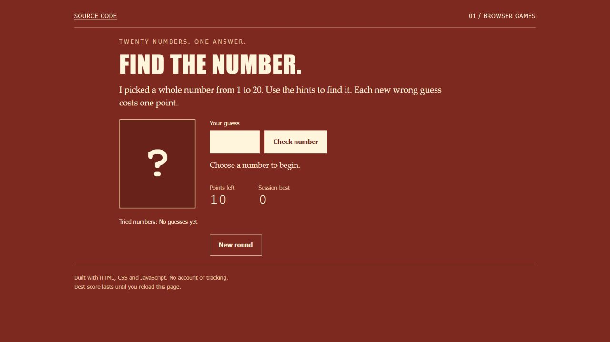
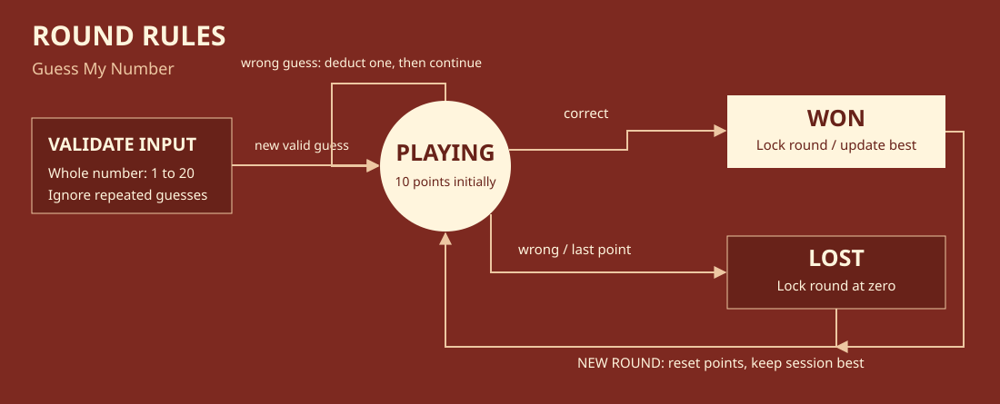

# Guess My Number

A small browser game with high/low hints, a session best score and keyboard controls. Find the hidden integer from 1 to 20 before the points run out.



[Open the live demo](https://ismaeelakin.github.io/Guess_My_Number_JS-Project/)

## Features

- Submit with Enter or the Check number button.
- Invalid inputs and repeated guesses do not cost points.
- A completed round stays locked until New round is selected.
- Reset preserves the best score for this page session.
- Guess history makes previous choices visible.

## Tech stack

HTML, CSS and JavaScript modules. The game rules use Node.js for tests; the browser app needs no packages.

## Play

Serve the repository with `python -m http.server 8092 --bind 127.0.0.1`, then open <http://127.0.0.1:8092/final/>. No dependencies or build step are needed. ES modules require a local server.

## Architecture



The rule functions are independent of the DOM. The browser adapter handles focus, events and the session best score. Rendering uses textContent; input never becomes HTML.

## Verify

```sh
node --test test/game.test.mjs
```

Five tests cover random bounds, invalid and duplicate guesses, completed-round locking, score exhaustion and independent state. Browser checks should include Enter, input errors, hints, a completed round and reset.

## Background and scope

This repository began as a JavaScript course exercise. `final/` contains the maintained game. The earlier scaffold remains in Git history. The rule model, validation, history and current interface extend that exercise. This is a small game, not a backend or multiplayer service. Scores are intentionally not saved after a reload.
